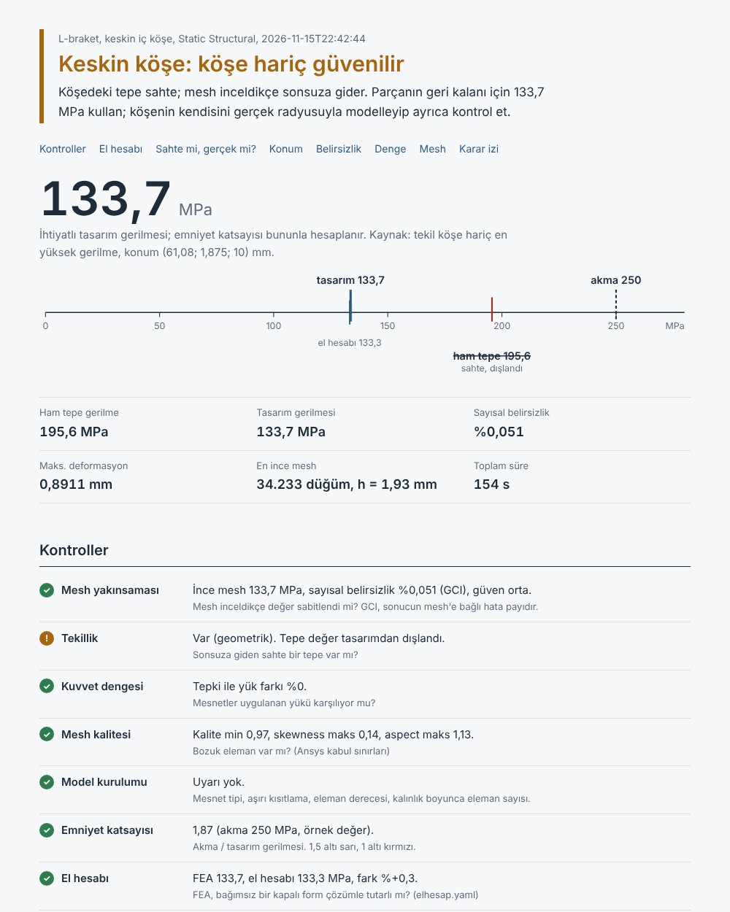
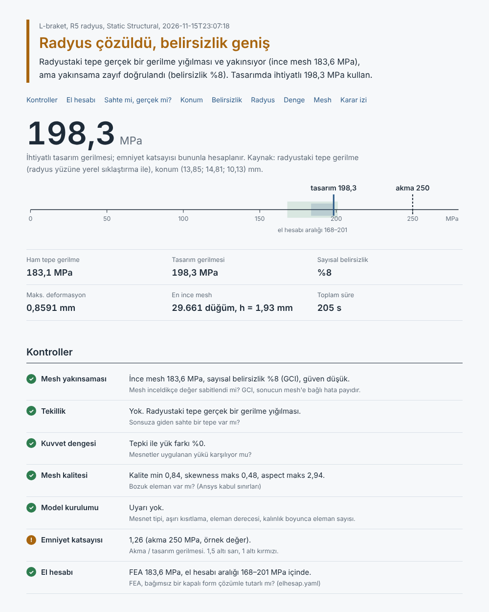

# feacheck — "Can I trust this FEA result?"

**feacheck** is a verification tool for linear static analyses in **Ansys Mechanical**. You set up your
model as usual (geometry, material, supports, loads), press one button, and feacheck re-solves the
analysis on a controlled mesh series and tells you:

- whether the peak stress is **real** (a genuine stress concentration) or a **numerical artefact**
  (a singularity at a support edge or a sharp re-entrant corner),
- the **discretisation uncertainty** of the result as a percentage (Grid Convergence Index),
- a **design stress** you can defend, with the full decision trail that led to it,
- a list of **set-up mistakes** it detected (over-constrained supports, fixed bolt holes,
  linear elements, too few elements through the thickness, unbalanced reactions …).

Output is a single self-contained HTML report.

> Scope: feacheck does *verification* (is the equation solved correctly on this mesh?), not
> *validation* (is the model a correct representation of the physical part?). Validation against
> strain-gauge / load tests on real parts is planned next.

## Why

A typical student FEA workflow ends with "max von Mises = 612 MPa → part fails". Very often that 612
comes from a single node at the edge of a fixed support or in a sharp corner; refine the mesh and it
becomes 800, then 1100 — it never converges, because the exact solution there is infinite. The
physically meaningful stress is somewhere else, and it is ~120 MPa. feacheck automates the checks an
experienced analyst does by hand to tell these two situations apart.

## How it works

1. **Mesh series.** Three global element sizes with a constant refinement ratio (r ≈ 1.5), sized from
   the part's characteristic length and thickness, kept under the student licence node limit.
2. **GCI / Richardson extrapolation** (Roache 1994; Celik et al. 2008, *J. Fluids Eng.*): observed order
   *p* by fixed-point iteration, extrapolated value, GCI = 1.25·|ε| / (rᵖ − 1). Monotone, oscillatory,
   divergent and "change below noise level" cases are classified explicitly.
3. **Singularity classification.** If the peak keeps growing under refinement, its location is
   compared with support/load faces (boundary-condition singularity) and with the face geometry:
   planar faces meeting at a sharp edge → geometric singularity (σ ∝ h^−q, Williams q ≈ 0.455 for a
   90° corner); a cylindrical fillet face → **under-resolved fillet**, not a singularity.
4. **Local fillet refinement.** For an under-resolved fillet feacheck runs an extra series refining only
   the fillet face (R/4 → R/6 → R/9, with a lower volume growth rate so the material beneath the fillet
   is refined too) and takes the fillet peak as the design value only if that series converges.
5. **Exclusion zone** (Saint-Venant): stresses within max √A of the support/load faces
   (bounded by 2·h₀ and L꜀/2) are excluded when a singularity is present.
6. **Design stress + confidence.** Candidates are ranked (converged peak → converged fillet peak →
   peak outside the exclusion zone → indicative value), and the conservative value
   max(fine, extrapolated) or fine·(1 + GCI) is reported together with a confidence level.
7. **Set-up checks.** Force balance (total and per support), internal-force ratio Σ|Rᵢ| / |ΣRᵢ|
   (over-constraint), Fixed Support on cylindrical faces, element order, elements through
   thickness, mesh quality metrics, yield exceedance, large-deflection warning.

Architecture: an IronPython 2.7 script runs inside Mechanical (solves, reads results, ASCII only);
a CPython package does all decision logic, storage and reporting, and is fully unit-tested
outside Ansys.

## Example reports

Same L-bracket, two geometries. Left: sharp inner corner → the corner peak diverges
(137 → 159 → 196 MPa) and is rejected as a geometric singularity; design stress 133.7 MPa is taken
outside the corner (hand calculation 133.3 MPa). Right: R5 fillet → the global series cannot resolve
the fillet, so feacheck refines the fillet face locally. The first real runs refined only the surface and the
peak kept rising (178 → 180 → 182 → 186 MPa, growing steps); feacheck refused to call it converged. With the
volume beneath the fillet refined too (growth rate 1.2, adaptive sizing off) the series converges
(180 → 182 → 184 MPa), but with a low observed order (p = 0.70), so feacheck uses Fs = 3, reports a wide
uncertainty (GCI 8 %) and designs with the top of the band: 198 MPa, inside the hand-calculation bounds.

| Sharp corner | R5 fillet |
|---|---|
|  |  |

Full HTML reports (report language is currently Turkish): [`examples/reports/`](examples/reports/),
regenerated from the stored raw results with `python examples/make_reports.py`.

## Verification cases

| Case | Reference | feacheck | Diff. | Verdict |
|---|---|---|---|---|
| Cantilever shaft Ø20×200, F = 500 N | Beam theory 113.3 MPa | 113.8 MPa (GCI 0.8 %) | 0.4 % | Support singularity rejected (raw peak 138 MPa) |
| Cantilever shaft, tip deflection | FL³/3EI = 0.849 mm | 0.8506 mm (GCI 0.07 %) | 0.2 % | Reliable |
| Plate with hole 200×50×5, Ø10, 10 kN | Peterson Kt = 2.51 → 125.3 MPa | 128.5 MPa (GCI 4.0 %) | 2.6 % | Reliable (hole = real concentration) |
| L-bracket, sharp inner corner | Bending 133.3 MPa | 133.7 MPa (corner excluded) | 0.3 % | Geometric singularity detected (peak 137→159→196 MPa diverges) |
| L-bracket, R5 fillet | Bounds 168 MPa (shoulder-fillet Kt) – 201 MPa (Winkler curved beam) | 183.6 MPa fine mesh, 198.3 MPa conservative (GCI 8 %) | within bounds | Converged after refining the volume beneath the fillet; low observed order → Fs = 3, low confidence |

The GCI implementation itself is checked against the worked example of Celik et al. (2008), Table 1
(p = 1.53, φ_ext = 6.1685, e_a = 1.5 %, e_ext = 1.7 %, GCI = 2.2 %): feacheck reproduces every number.

**Reproducibility.** The same R5 model solved on two different days gives identical node counts and
stresses to the last digit (`test_r5_tekrarlanabilir`).

**Hand calculations.** `feacheck/handcalc.py` provides closed-form references (beam bending and torsion,
cantilever deflection, Winkler curved beam, Peterson/Heywood Kt for a plate with a hole, Roark/Pilkey Kt for
shaft shoulders in bending, tension and torsion; fits raise an error outside their validity range). Put a
value or a lower/upper bound per model in `elhesap.yaml` and the report compares the FEA result with it.

All cases are stored as raw-result fixtures and run as regression tests (`pytest`, 61 tests,
no Ansys required).

## Installation (Windows)

```
conda create -n cadfea python=3.12 -y
conda activate cadfea
pip install -e .
feacheck setup
```

`feacheck setup` creates a Mechanical button script (`execfile(r"...\feacheck\feacheck_button.py")`,
paste into Automation › Scripting or save as a User Button) and a desktop `feacheck.bat`.

## Usage

1. Build your model in Mechanical; leave the mesh at default.
2. Select the analysis in the tree, run the button. The report opens in your browser after a few
   minutes.
3. Re-solve once afterwards for your own results (feacheck leaves the mesh at the last series level).

```
feacheck converge model.mechdb --yield 250   # run headless
feacheck log                                 # history
feacheck show <id>                           # reopen a report
```

**Self-test.** A second Mechanical button runs the error catalogue on any open model: it deliberately breaks the
model (linear elements, 5× load, extra Fixed support, Fixed on a curved face, no supports), runs feacheck for each case,
restores the model after every case and opens a pass/fail summary (`docs/HATA_KATALOGU.md`, in Turkish).

## Limitations

- Linear static, solid models; shells/beams, contact and nonlinear materials are not yet handled.
- Thresholds for the over-constraint warning are provisional and will be calibrated on a catalogue of
  deliberately broken models.
- Verification only — see "Scope" above.

## Roadmap

Error catalogue of broken models · real rover/UGV part pilot with hand calculation · load-case module
in front of feacheck · physical validation with strain gauges.

## References

- Roache, P. J. (1994). Perspective: A Method for Uniform Reporting of Grid Refinement Studies. *J. Fluids Eng.* 116.
- Celik, I. B. et al. (2008). Procedure for Estimation and Reporting of Uncertainty Due to Discretization in CFD Applications. *J. Fluids Eng.* 130.
- Williams, M. L. (1952). Stress singularities resulting from various boundary conditions in angular corners of plates in extension.
- Pilkey, W. D., Pilkey, D. F. *Peterson's Stress Concentration Factors*.
- ASME V&V 10-2019, *Standard for Verification and Validation in Computational Solid Mechanics*.
