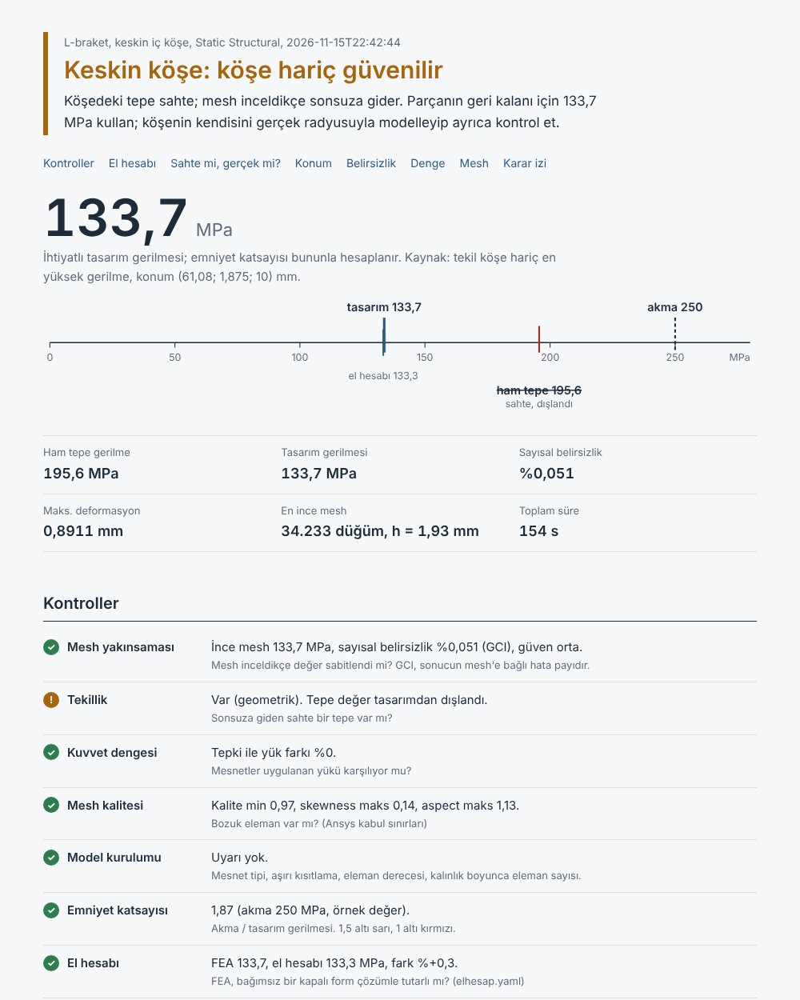
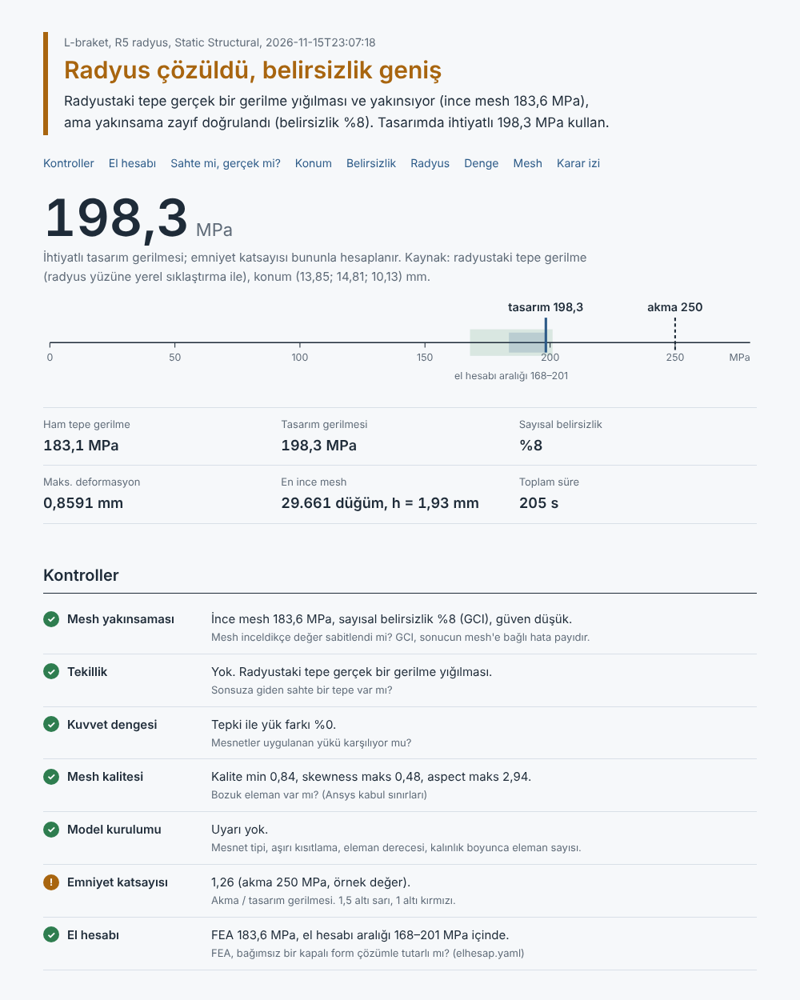

# feacheck — Ansys Mechanical sonuç doğrulama aracı

> "Bu FEA sonucuna güvenebilir miyim?" sorusunu otomatik cevaplar. (English: [README.en.md](README.en.md))

Ansys Mechanical'da modelini (geometri, malzeme, sınır şartları) her zamanki gibi kurarsın. feacheck butonuna
basınca araç seçili analizi farklı mesh boyutlarıyla çözer ve şunları raporlar:

| Kontrol | Ne yapar |
|---|---|
| **Mesh yakınsaması + GCI** | Roache/Celik (2008) Grid Convergence Index ile sayısal belirsizliği **yüzde** olarak verir; Richardson ekstrapolasyonu |
| **Tekillik tespiti** | Mesh inceldikçe sonsuza giden gerilmeleri bulur ve sınıflandırır: **sınır şartı tekilliği** (mesnet/yük kenarı) veya **geometrik tekillik** (radyussuz iç köşe) |
| **Tasarım gerilmesi** | Tekillik varsa fiziksel olmayan tepeyi reddeder; tekillikten uzakta sabit bir noktadaki (probe) yakınsamış değeri verir |
| **Denge kontrolü** | Mesnet tepkileri uygulanan kuvveti karşılıyor mu (bileşen veya vektör tanımlı kuvvet) |
| **Mesh kalitesi** | Element quality, skewness, aspect ratio; Ansys kabul sınırlarıyla karşılaştırma |
| **Güvenlik katsayısı** | Akma dayanımı malzeme verisinden (Engineering Data) okunur |
| **Fiziksel geçerlilik** | Akma aşımı (doğrusal analiz geçersiz), büyük deformasyon (Large Deflection gerekir) uyarıları |
| **Geçmiş** | Her kontrol `%USERPROFILE%\feacheck\.feacheck` altında saklanır (`feacheck log`) |

Öğrenci lisansındaki **128 bin düğüm** sınırına uyar.

## Hesapların doğrulanması

- **GCI:** Celik vd. (2008) makalesinin Tablo 1'deki çözülmüş örneği (p = 1,53, φ_ext = 6,1685, e_a = %1,5,
  e_ext = %1,7, GCI = %2,2) birebir tekrar üretiliyor (`tests/test_feacheck.py`).
- **El hesabı modülü** (`feacheck/handcalc.py`): kiriş eğilme/burulma, konsol sehimi, Winkler eğri kiriş,
  delikli levha Kt (Heywood/Peterson), mil omzu Kt (Roark/Pilkey; eğilme, çekme, burulma). Eğri uydurmaları
  geçerlilik aralığı dışında hata verir. `elhesap.yaml`'a model adına göre değer ya da alt/üst sınır yazılırsa
  rapor FEA sonucunu otomatik karşılaştırır.

Ayrıntılı kullanım: [docs/KULLANIM.md](docs/KULLANIM.md) · Nasıl çalışır: [docs/NASIL_CALISIR.md](docs/NASIL_CALISIR.md) · Hata kataloğu ve öz test: [docs/HATA_KATALOGU.md](docs/HATA_KATALOGU.md) · Değişiklikler: [CHANGELOG.md](CHANGELOG.md)

## Örnek raporlar

| Keskin köşe (tekillik ayrıldı, köşe hariç 133,7 MPa) | R5 radyus (radyus altı hacim de inceltilince yakınsadı: 183,6 MPa, ihtiyatlı 198,3) |
|---|---|
|  |  |

Tüm HTML raporlar `examples/reports/` altında; `python examples/make_reports.py` ile kayıtlı ham sonuçlardan yeniden üretilir.

## Doğrulama vakaları

| Vaka | Referans | feacheck | Fark | Karar |
|---|---|---|---|---|
| Konsol aks Ø20×200, F = 500 N, z = 22 mm | Kiriş teorisi 113,3 MPa | 113,8 MPa (GCI %0,8) | %0,4 | Mesnet tekilliği doğru ayrıldı (ham maks. 138 MPa) |
| Konsol aks, uç sehim | FL³/3EI = 0,849 mm | 0,8506 mm (GCI %0,07) | %0,2 | Güvenilir |
| Delikli plaka 200×50×5, Ø10, F = 10 kN | Peterson Kt = 2,51 → 125,3 MPa | 128,5 MPa (GCI %4,0) | %2,6 | Güvenilir (delik = gerçek konsantrasyon, tekillik değil) |
| Denge (aks) | 500 N | 500 N | %0,0 | ✓ |
| L-braket, keskin iç köşe | Eğilme 133,3 MPa | 133,7 MPa (köşe hariç) | %0,3 | Geometrik tekillik ayrıldı (tepe 137→159→196 MPa ıraksıyor) |
| L-braket, R5 radyus | Alt sınır 168 MPa (omuz Kt), üst 201 MPa (Winkler) | 183,6 MPa ince mesh, 198,3 MPa ihtiyatlı (GCI %8) | aralıkta | Yalnız yüzey inceltilince yakınsamadı (186,2'ye tırmandı, araç reddetti); radyus altı hacim de inceltilince yakınsadı. p = 0,70 düşük → Fs = 3, güven düşük |
| L-braket, R2 radyus | Winkler eğri kiriş (M = F·60 mm) + F/A = 255,7 MPa | 260,6 MPa (radyus serisi 253,3 → 261,0 → 260,6) | %1,9 | Yakınsadı (17.11, gerçek koşu) |
| L-braket, R1 radyus | Winkler aynı varsayımla 349,9 MPa | 365,6 MPa gösterge (354,8 → 357,9 → 365,6) | %4,5 | Yakınsamadı: artış hızlanıyor, 4. seviye 128 bin düğüm sınırına takıldı; araç güvenilir demedi |

## Kurulum (Windows, bir kez)

```
conda create -n cadfea python=3.12 -y
conda activate cadfea
cd cad-fea-bridge
pip install -e .
feacheck setup
```

`feacheck setup` iki şey kurar:
1. **Mechanical butonu**: Mechanical > Automation > Scripting'e aşağıdaki satırı yapıştır (ya da User Button olarak kaydet):
   ```
   execfile(r"C:\Users\<kullanıcı>\feacheck\feacheck_button.py")
   ```
   Buton her çalıştığında en güncel kodu kendisi üretir; güncellemeden sonra setup'ı tekrar çalıştırmaya gerek yok.
2. **Masaüstünde `feacheck.bat`**: bir `.mechdb` dosyasını üzerine sürükle-bırak (Ansys'i arka planda açar).

## Kullanım

1. Mechanical'da modelini kur: geometri, malzeme, mesnet, yük. **Mesh'e dokunma** (varsayılan kalsın).
2. Ağaçta kontrol edilecek **analize** tıkla.
3. Butonu çalıştır. Birkaç dakika sonra rapor tarayıcıda açılır.
4. Bitince modelin mesh/çözümü güncel değildir; kendi sonuçların için bir kez **Solve** et.

Komut satırı:
```
feacheck converge model.mechdb --yield 250   # Ansys'i arka planda açarak
feacheck log                                 # geçmiş kontroller
feacheck show <id>                           # bir raporu aç
```

## Ayarlar — `%USERPROFILE%\feacheck\ayarlar.yaml`

```yaml
dugum_limiti: 128000        # öğrenci lisansı
gci_esigi_yuzde: 5          # bu belirsizliğin altı 'güvenilir'
mesh_seviye_sayisi: 3
incelme_orani: 1.5
yerel_siklastirma: false    # DENEYSEL: sadece kritik bölgeyi incelt
```

## Yöntem

**Mesh seviyeleri.** Karakteristik boy `Lc = V^(1/3)`. İlk eleman boyu `Lc/8`, her seviyede 1,5'e bölünür.
Kullanıcının kendi lokal sizing'leri global boyutla orantılı ölçeklenir.

**GCI (Celik et al., J. Fluids Eng. 130, 2008).** Üç mesh (1 ince, 3 kaba), temsilî boy `h = (1/N)^(1/3)`:
```
r21 = h2/h1,  ε21 = φ2 − φ1,  ε32 = φ3 − φ2
p  = |ln|ε32/ε21| + q(p)| / ln r21,   q(p) = ln((r21^p − s)/(r32^p − s))   (sabit nokta iterasyonu)
φ_ext = (r21^p φ1 − φ2)/(r21^p − 1)
GCI_fine = 1.25 · |(φ1 − φ2)/φ1| / (r21^p − 1)
```
Salınımlı yakınsamada (ε32/ε21 < 0) belirsizlik yarım aralık olarak alınır.

**Tekillik.** σ ∝ h^(−q) büyüme üssü hesaplanır. 90° iç köşede elastisite teorisi q ≈ 0,46 verir;
yakınsayan bir büyüklükte q → 0. Büyüyen ve yakınsamayan bir maksimum:
- bir mesnet/yük yüzeyinin `Lc/2` (Saint-Venant) yakınındaysa → **sınır şartı tekilliği**: tasarım gerilmesi bu bölgenin dışındaki sabit noktadan (probe) okunur,
- değilse ve q > 0,1 ise → **geometrik tekillik**: köşe hariç parçanın geri kalanındaki maksimum verilir, köşeye radyus önerilir.

**Probe.** İlk mesh'te dışlama bölgesi dışındaki en yüksek gerilmeli düğümün koordinatı; sonraki mesh'lerde bu
noktanın eleman boyu yarıçapındaki en yüksek değer okunur (yüzey tepe değerini kaçırmamak için).

## Bilinen sınırlar

- Sadece doğrusal statik yapısal analiz.
- Dışlama bölgesi `Lc/2` sezgisel bir değer; mesnete çok yakın gerçek bir radyuslu köşe dışlanabilir.
- Yerel sıklaştırma deneysel (varsayılan kapalı).
- Ansys 2024 R1 Student/Enterprise ile test edildi; IronPython 2.7 ortamında çalışır.

## Mimari

```
Mechanical (IronPython)                         CPython (conda env)
┌──────────────────────────┐   raw.json    ┌──────────────────────────────┐
│ feacheck_button.py       │ ────────────► │ feacheck finalize            │
│  └ mech_converge.TEMPLATE│               │  ├ gci.py      (GCI/Richardson)│
│     mesh → solve → oku   │               │  ├ analysis.py (karar mantığı) │
└──────────────────────────┘               │  ├ matml.py    (akma okuma)    │
                                           │  ├ report.py   (HTML + SVG)    │
PyMechanical (gRPC) ◄── feacheck converge  │  └ store.py    (geçmiş)        │
                                           └──────────────────────────────┘
```

`cadfea/` paketi: STEP'ten otomatik sınır şartı kurulumu, teknik resim taslağı, ISO 286 geçme, tolerans zinciri,
GD&T ve el hesapları (ikincil araçlar).

## Lisans

MIT, bkz. [LICENSE](LICENSE). Mühendislik kararı için tek başına yeterli değildir; sonuçları kendi el hesabınla doğrula.
